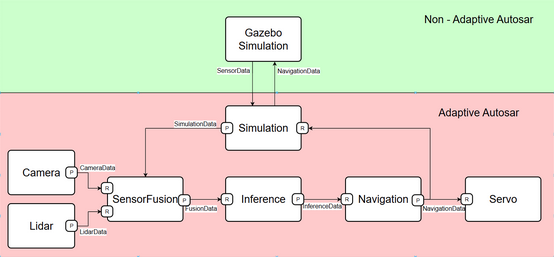
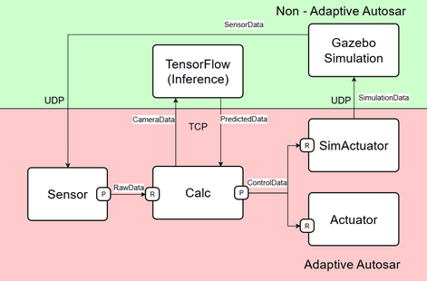
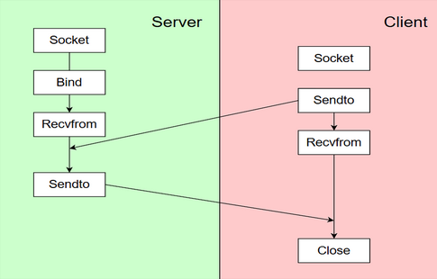

# DeepRacer

2024 임베디드SW경진대회 자율주행 레이싱 부문에서 개발한 AWS DeepRacer 기반 자율주행 시스템입니다. 팀 `전농동CAR리나`는 인식, 판단, 제어 과정을 Adaptive AUTOSAR R20-11 구조의 Adaptive Application으로 분리하고, 강화학습 모델의 추론 결과를 실제 차량 또는 Gazebo 시뮬레이션 제어값으로 전달하는 구조를 구현했습니다.

## 프로젝트 개요

목표는 스테레오 카메라 입력을 기반으로 차선과 장애물 상황을 인식하고, 강화학습 모델을 통해 안정적이면서 빠르게 완주할 수 있는 조향각과 속도를 계산하는 것입니다. 전체 시스템은 차량 로봇의 기본 흐름인 `Recognize -> Decision -> Control`을 기준으로 모듈화했습니다.

Adaptive AUTOSAR 구조를 적용해 센서 입력, 모델 추론, 제어값 송신, 실제 액추에이터 구동, 시뮬레이션 구동을 각각 독립된 Adaptive Application으로 나누었습니다. 이를 통해 각 모듈을 개별 개발, 테스트, 배포할 수 있도록 구성했습니다.

## 개발 환경

| 구분 | 내용 |
| --- | --- |
| 플랫폼 | AWS DeepRacer Evo |
| 표준 | Adaptive AUTOSAR R20-11 |
| 운영체제 | Ubuntu 20.04 LTS |
| 언어 | C++11/14, Python 3 |
| 영상 처리 | OpenCV |
| 모델 학습 | AWS SageMaker, PPO |
| 모델 추론 | TensorFlow, OpenVINO IR |
| 통신 | SOME/IP 기반 AA 포트, TCP socket, UDP socket |
| 시뮬레이션 | Gazebo, Docker Ubuntu 환경 |

## 시스템 구조



### Adaptive Applications

| 모듈 | 역할 |
| --- | --- |
| `Sensor AA` | 스테레오 카메라 또는 시뮬레이션 데이터를 수집하고 120x160 grayscale 이미지로 전처리 |
| `Calc AA` | RawData를 모델 입력으로 전달하고 추론 결과를 조향각/속도 제어값으로 매핑 |
| `Actuator AA` | 실제 DeepRacer의 steering, throttle PWM을 제어 |
| `SimActuator AA` | Gazebo 시뮬레이션으로 제어값을 송신 |
| `SM` | MachineFG와 DeepRacerFG 상태 전환 및 실행 모드 관리 |
| `CM` | AA 간 서비스 매핑과 통신 경로 설정 |
| `EM` | 전체 Adaptive Application 실행과 종료 순서 관리 |

## 전체 동작 Flow

1. `EM`이 실행되며 Adaptive AUTOSAR 실행 환경을 시작합니다.
2. `EM`은 `CM`을 실행하고, `CM`은 각 Adaptive Application 사이의 통신 경로를 초기화합니다.
3. `SM`은 실행 인자와 Function Group 상태에 따라 실제 차량 모드 또는 시뮬레이션 모드를 결정합니다.
4. `Sensor AA`는 실제 모드에서는 AWS DeepRacer의 좌우 스테레오 카메라를 열고, 시뮬레이션 모드에서는 Gazebo 송신기로부터 UDP 데이터를 수신합니다.
5. 실제 카메라 입력은 OpenCV `VideoCapture`로 읽은 뒤 160x120 해상도의 grayscale 이미지로 변환합니다.
6. 좌/우 이미지는 각각 19,200 byte 벡터로 flatten되고, 두 벡터를 합쳐 38,400 byte RawData로 구성합니다.
7. `Sensor AA`는 RawData를 `REvent`로 발행합니다.
8. `Calc AA`는 RawData를 수신해 OpenVINO inference wrapper 또는 TensorFlow inference server로 전달합니다.
9. 추론 모듈은 `1x120x160x2` stereo image tensor를 입력으로 받아 steering과 throttle에 대응하는 모델 출력을 계산합니다.
10. `Calc AA`는 모델 출력이 `[-1.0, 1.0]` 범위를 벗어나지 않도록 clamp하고, throttle은 실제 구동에 맞는 비선형 매핑을 적용합니다.
11. 변환된 `{steering, throttle}` 값은 `ControlData`의 `CEvent`로 발행됩니다.
12. 실제 차량 모드에서는 `Actuator AA`가 calibration 값을 반영해 steering servo와 motor PWM duty cycle을 설정합니다.
13. 시뮬레이션 모드에서는 `SimActuator AA`가 Gazebo 환경으로 제어값을 전달합니다.
14. 차량 또는 시뮬레이터가 제어값에 따라 주행하고, 다음 센서 프레임부터 같은 과정이 반복됩니다.

## 통신 구조

### TCP Communication



`Calc AA`와 non-AA inference server는 TCP socket으로 연결됩니다. `Calc AA`가 38,400 byte stereo image buffer를 전송하면 inference server는 TensorFlow 모델을 실행하고, `float steering`, `float throttle` 두 값을 pack해 다시 반환합니다. 고정 크기 버퍼를 끝까지 수신한 뒤 추론을 수행해 이미지 데이터가 중간에 잘리는 상황을 줄였습니다.

### UDP Communication



시뮬레이션 모드에서는 Docker Ubuntu 환경의 Gazebo sender가 카메라와 LiDAR ROS topic을 읽습니다. 좌/우 카메라 이미지는 grayscale, resize, flatten 과정을 거치고 LiDAR는 8개 섹터 상태로 축약됩니다. 이후 `{timestamp, left_image, right_image, lidar_status}` 패킷을 UDP로 전송하며, `Sensor AA`가 이를 수신해 실제 센서와 동일한 RawData 형태로 변환합니다.

## 강화학습 모델

모델은 AWS SageMaker 기반 DeepRacer 학습 환경에서 PPO 알고리즘으로 학습했습니다. 미션은 정적 장애물이 있는 트랙을 안정적으로 완주하는 것이므로, 급격한 정책 변화보다 안정적인 정책 갱신이 중요하다고 판단해 PPO를 사용했습니다.

### 보상 함수 구성

| 보상 항목 | 목적 |
| --- | --- |
| 중앙선 유지 보상 | 차량이 트랙 중앙에 가깝게 주행하도록 유도 |
| 장애물 회피 보상 | 같은 차선의 장애물과 안전거리를 유지하도록 유도 |
| 코너 감속 보상 | heading과 track direction 차이가 큰 구간에서 속도를 낮추도록 유도 |

장애물 회피는 차량과 장애물의 중심 좌표뿐 아니라 차량 폭과 장애물 폭을 함께 고려했습니다. 실차 주행에서 경계선 단차로 차체가 기울어지는 문제가 있었기 때문에 `all_wheels_on_track` 조건을 보상에 강하게 반영했습니다.

## 코드 구조

```text
DeepRacer/
├── Inference.py
├── README.md
├── activate
├── docs/
│   ├── TCPcommunication.png
│   ├── UDPcommunication.png
│   └── totalstructure.png
├── model/
│   ├── For1st-AvOb-microcontroled-model.tar.gz
│   ├── model_metadata.json
│   ├── saved_model.xml
│   └── worker_0.multi_agent_graph_0.json
├── project/
│   ├── Actuator/
│   ├── Calc/
│   ├── CM/
│   ├── EM/
│   ├── SM/
│   ├── Sensor/
│   └── SimActuator/
└── scripts/
    ├── carina-ssh
    ├── deploy
    └── ngrok-env
```

## 주요 파일

| 파일 | 설명 |
| --- | --- |
| `project/Sensor/src/sensor/aa/sensor.cpp` | 스테레오 카메라 또는 UDP 시뮬레이션 데이터 수신, grayscale 변환, flatten, RawData 발행 |
| `project/Calc/src/calc/aa/calc.cpp` | RawData 수신, 모델 추론 호출, steering/throttle 매핑, ControlData 발행 |
| `project/Calc/src/calc/aa/inference_engine_wrapper.cpp` | OpenVINO IR 모델 로드 및 추론 래퍼 |
| `project/Actuator/src/actuator/aa/servo_mgr.cpp` | DeepRacer calibration 기반 steering/motor PWM duty 제어 |
| `project/SimActuator/src/simactuator/aa/simactuator.cpp` | 시뮬레이션용 제어 데이터 수신 |
| `Inference.py` | TensorFlow 모델 추론 TCP server |
| `scripts/deploy` | 원격 DeepRacer 환경 빌드, 설치, 실행 자동화 |

## 실행 방법

개발 환경 활성화:

```bash
source activate
```

원격 DeepRacer 접속:

```bash
carina-ssh
```

원격 빌드 및 실행:

```bash
deploy
```

수동 빌드:

```bash
export PARA_SDK=$PWD/work
export PARA_CORE=$PARA_SDK
export PARA_CONF=$PARA_SDK/etc
export PARA_APPL=$PARA_SDK/opt
export PARA_DATA=$PARA_SDK/var
export LD_LIBRARY_PATH=$PARA_SDK/lib

cd project
cmake -B build -D CMAKE_INSTALL_PREFIX=$PARA_SDK
cmake --build build -j $(nproc)
cmake --install build
```

TensorFlow inference server 실행:

```bash
python3 Inference.py \
  --model-path /home/ubuntu/test_socket/model.pb \
  --host 0.0.0.0 \
  --port 8080
```

## 문제 해결 과정

- 실제 트랙 가장자리와 트랙 외부 사이의 단차로 차량이 기울어지는 문제가 있었습니다. 보상 함수에서 `all_wheels_on_track` 조건을 강하게 반영해 차량이 트랙 내부에 머무르도록 조정했습니다.
- 장애물과 차량 중심만 비교하면 실제 차폭과 장애물 폭을 반영하지 못해 아슬아슬한 충돌 상황이 발생했습니다. 차량 폭과 장애물 폭을 고려한 안전거리 판단으로 회피 보상을 보완했습니다.
- 모델 출력이 일부 상황에서 기대 범위 밖으로 튀는 문제가 있었습니다. tanh 출력 범위를 기준으로 steering/throttle 값을 clamp해 actuator 입력 안정성을 높였습니다.
- 실환경 조명에 따라 이미지가 번지거나 차선 인식이 불안정해지는 문제가 있었습니다. 입력 이미지를 grayscale, resize, flatten하는 일관된 전처리 파이프라인으로 모델 입력을 고정했습니다.
